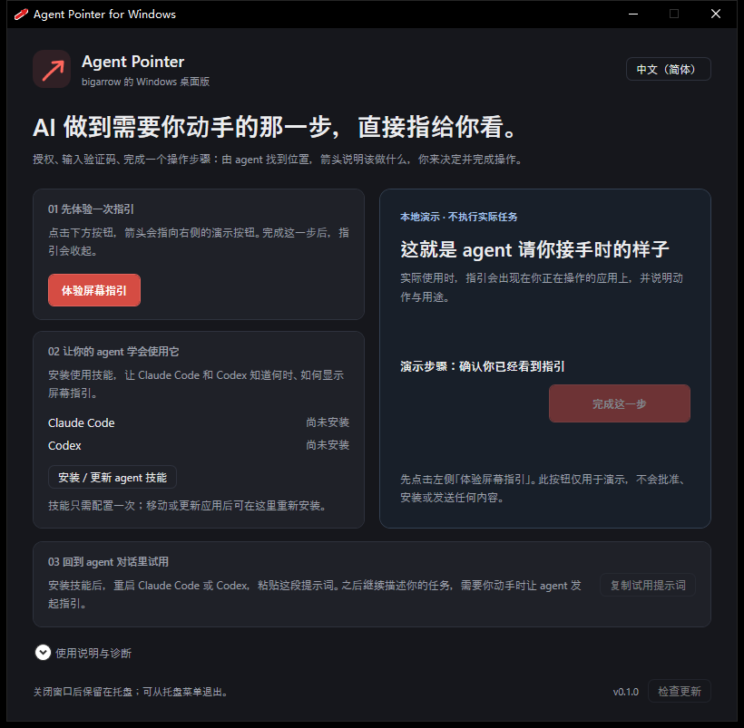

**English** | [简体中文](README.zh-CN.md)

# Agent Pointer for Windows

**A Windows desktop port of bigarrow: when an AI task needs your hand, show exactly where to act.**

When a task needs an approval, a verification code, or a step inside another app,
Claude Code / Codex can display an arrow with an action label. You decide and complete the action.
This unofficial port adapts layout algorithms and some CLI conventions from
[bigarrow](https://github.com/franzenzenhofer/big-arrow-on-the-screen), with a C# / WinForms / WPF overlay and desktop setup panel.

[Download Windows installer](https://github.com/castorhrio/agent-pointer-desktop/releases/latest/download/agentpointer-0.1.1-win-x64-setup.exe) · [All releases](https://github.com/castorhrio/agent-pointer-desktop/releases) · [Report an issue](https://github.com/castorhrio/agent-pointer-desktop/issues)



## Status

`v0.1.1` — a single-file Windows installer, system language detection, and a fix for duplicate tray icons during repeated window loading.

Verified with the actual package: installation into an isolated directory, visible desktop startup,
a real click through the demo, closing to the tray, reopening a single instance, and language selection. Separate-process
checks cover click-through, prompt return from `start`, owner isolation, display conversion, and exit codes.
Claude Code / Codex skill file status can be checked; complete tasks in a live agent session still need user validation.

## Features

| Feature | Behavior |
|---|---|
| On-screen guidance | An arrow and action label show where to complete the next step |
| Local demo | Try the guidance and completion flow before setting up an agent |
| Agent setup | Install Claude Code / Codex skills and check that files match the current app |
| Focus preservation | Guidance keeps your current input focus; explicit `--raise` requests foreground activation |
| Click-through | Mouse clicks reach the app beneath the overlay, verified across processes |
| Click to dismiss | A click on the action label or the arrow shaft ends the guidance right away; the target stays click-through |
| Attention | `--say` reads the action text aloud (`--voice` picks the voice), `--flash` blinks the target window's taskbar button, `--notify` shows a Windows notification |
| Multiple agents | Stop guidance by owner; overlays disappear when their owner exits |
| Desktop and CLI | The panel handles setup and demos; agents can call the CLI independently |
| System language | Follow the Windows display language by default, with manual English / Chinese choices |

## Install

Requires **Windows 10/11 x64**. Download the installer from
[GitHub Releases](https://github.com/castorhrio/agent-pointer-desktop/releases/latest) and double-click it.
No .NET installation or development tools are required on the target computer.

| Download | Purpose |
|---|---|
| [agentpointer-0.1.1-win-x64-setup.exe](https://github.com/castorhrio/agent-pointer-desktop/releases/latest/download/agentpointer-0.1.1-win-x64-setup.exe) | Recommended: one file with an installation wizard |
| [Portable ZIP](https://github.com/castorhrio/agent-pointer-desktop/releases/latest/download/agentpointer-0.1.1-win-x64.zip) | Advanced use: the complete unpacked application |
| [SHA-256 checksums](https://github.com/castorhrio/agent-pointer-desktop/releases/latest/download/agentpointer-0.1.1-win-x64.sha256) | Verify either download |

**Recommended — install.** Run `agentpointer-0.1.1-win-x64-setup.exe` and follow the wizard.
It selects Chinese or English from your Windows display language, lets you choose an installation directory,
creates desktop and Start-menu shortcuts, and offers to open the app when finished.
The default directory is `%LOCALAPPDATA%\Programs\AgentPointer`. No administrator rights are required.
The app follows the Windows display language on first launch. Its language menu includes **跟随系统 / System**,
**中文（简体）**, and **English**; manual choices are remembered.
Choose whether to install agent skills in the app. The wizard leaves skills and PATH unchanged;
installed skills use the CLI's absolute path.

**Advanced — portable ZIP.** Extract the entire ZIP and double-click `AgentPointer.Desktop.exe`.
Keep the entire extracted directory together: the app needs its adjacent CLI and runtime files.

The download includes:

- `AgentPointer.Desktop.exe`: desktop setup, demo, and tray entry point.
- `agentpointer.exe`: the guidance tool for agents, with embedded skills and Codex metadata.
- The self-contained runtime, installation scripts, both README languages, and license notices.

The ZIP also retains `Install.cmd` and a PowerShell installer for scripted installation:

```powershell
powershell -NoProfile -ExecutionPolicy Bypass -File .\Install.ps1
```

`Install.ps1 -NoPath -NoShortcut -NoLaunch` skips PATH changes, shortcuts, and launch.
Use `-Destination <directory>` to choose a location, or `-InstallSkills` to install skills during a headless setup.
`AgentPointer.Desktop.exe --background` starts only the tray app.

The package is not Authenticode signed; Windows may show a SmartScreen warning after download.
**Check for updates** compares the latest release in this repository and provides its page link when a newer version is available.
To update, download the package, exit the running app, then extract it or run the installer again.

To uninstall the setup version, use **Settings → Apps → Agent Pointer** or **Uninstall Agent Pointer**
in the Start menu. Uninstallation keeps your app preferences, installed agent skills, and unrelated files.
Remove the two agentpointer skill directories separately if you no longer need them.
For a portable/script installation, remove its directory and any PATH entry or shortcuts you added.

## First run

1. Open **Agent Pointer** and click **Try the demo**. The arrow points at a demo button; clicking the completion button ends the demo.
2. Click **Install / update agent skills** to configure the usage instructions for Claude Code and Codex.
3. Restart your agent, click **Copy a test prompt**, and paste it into a new agent session.
4. Continue describing your task in the agent conversation, asking it to show guidance when a step needs your action.

The desktop demo is local. Its button only ends the demo; it does not approve or execute a real task.
“Skill installed” means the files are configured, without implying a running agent or a live connection.
The app does not read or monitor conversations. Actual guidance starts when an agent calls the tool.

Closing the window keeps the app in the tray. Opening it again returns to the same instance; use the tray menu to exit.
The CLI works independently, so ordinary guidance does not require the desktop panel to stay open.

## Claude Code / Codex integration

For manual CLI use, open PowerShell in the installation directory and run `./agentpointer.exe ...`,
or add that directory to your user PATH. The command examples below assume PATH is configured.

The desktop action uses the same installation path as these commands:

```powershell
agentpointer install-skill --dry-run --json
agentpointer install-skill --json
```

The skill comes from [skills/agentpointer/SKILL.md](skills/agentpointer/SKILL.md), with
`agents/openai.yaml` for Codex display metadata. Both are embedded in the CLI and need no separate download.
The default installation directories are:

- `%USERPROFILE%\.claude\skills\agentpointer\`
- `%USERPROFILE%\.agents\skills\agentpointer\`

Installation updates only the files inside these two tool-specific directories, leaving other agent settings and hooks intact.
It writes the current CLI's absolute path so portable use can work without PATH; reinstall the skills after moving the app.
`--dry-run --json` reports whether each agent's skill exists and matches the current program version and path.
The desktop uses this for “Not installed”, “Skill installed”, and “Update needed”; these describe file status.

The skill explains coordinates, non-blocking calls, action text, owner isolation, and limitations.
For a real task, include a complete action such as “Click Allow to let this app access your files”.
The default label when `--text` is omitted only identifies a location; it cannot explain the task.

## Commands

| Command | Behavior |
|---|---|
| `point` | Show guidance and wait until it ends; default 8 seconds |
| `start` | Return after the overlay appears; default 300 seconds, `--duration 0` has no time limit |
| `stop` | Stop only the same owner's overlays; without an owner, stop only unowned overlays |
| `stop --all` | Clear all overlays in the current Windows session |
| `stop --hook` | Require an owner environment variable and clear that owner's overlays; quiet if none exist |
| `doctor` | Report displays, DPI, desktop availability, overlay styles, and hit testing |
| `install-skill` | Install skill files for both agents |
| `elements` | List the elements a window exposes to `--element`, filtered by `--role` and `--match` |

Targets are mutually exclusive: `--at X,Y`, `--rect X,Y,W,H`, `--mouse`, or `--window App[:title]`.
`--element <label>` targets a UI Automation element inside `--app` / `--window` (or the foreground
window when neither is given), by label plus an optional `--role`, and draws on the element's bounding box
through the same path as `--rect`. JSON results echo the matched element. `elements` lists what is available:

```powershell
agentpointer point --app notepad --element "File" --role menuitem --text "Click File to continue"
agentpointer elements --app notepad --match "file" --json
```
`--app` is an alias for `--window`. Windows are matched by process name. By default, matching preserves focus;
`--raise` explicitly requests foreground activation, and `--no-raise` takes precedence.
`--dry-run` draws nothing and never changes focus.

Appearance options include `--text`, `--from`, `--color`, `--size S|M|L`, `--shape bend|straight`,
`--corners round|sharp`, `--border shadow|white-black|black`, `--border-color`, and `--text-color`.
`--close-button` puts a small × inside the action label. `--no-animation` disables entrance, breathing,
and fade animations. See `agentpointer --help` for all options.

`--say` reads the action text aloud as soon as the guidance appears, on a background thread, so the arrow
is never delayed by the voice. `{{value}}` placeholders are spoken as the bare value, without braces.
`--voice <name>` selects an installed voice by a case-insensitive name match; an unknown name is not an
error: the default voice is used and a warning goes to stderr. `--flash` blinks the target window's
taskbar button three times when that window is not in the foreground, and `--notify` adds a Windows
notification titled "AgentPointer". Both are off by default; `--flash` needs a window or element target.
Failure of any of these three is reported on stderr only and never affects the arrow.

A click on the action label or the arrow shaft ends the guidance immediately, without a round trip
through the agent; the target itself and the space around the arrow head stay click-through.
`--until-click` ends the guidance when the human clicks the target, `--until-any-click` when they
click anywhere. Both watch the mouse without swallowing the click: it still reaches the app.

`{{value}}` in `--text` becomes a copy button: the braces are not drawn, one click copies the whole
value to the clipboard, the icon turns into a check mark for about a second, and the guidance stays
up. Clicking the rest of the action label still dismisses it as usual, and the JSON result lists the
values under `values`.

```powershell
agentpointer start --app chrome --element "PIN" --text "copy & paste the PIN {{482913}} here"
```

Claude Code can clear leftover guidance the moment you send a new prompt:

```json
{"hooks": {"UserPromptSubmit": [{"hooks": [{"type": "command", "command": "agentpointer stop --hook"}]}]}}
```

`stop --hook` reads and ignores its stdin, prints nothing to stdout, and always exits 0, so it can
never block a prompt. Without `--hook`, `stop` still reports what it did.

## Coordinates and displays

All input and output coordinates use **physical pixels**. `(0,0)` is the primary display's top-left corner;
negative coordinates are valid. Display numbering starts at **1** in `doctor`, `--display`, text output, and JSON.

- With `--display N`, `--at` / `--rect` are relative to that display's top-left corner. Conversion happens before display selection and validation.
- `--window` / `--mouse` already produce global coordinates. `--display N` filters their target display without translating again.
- Targets outside every display, including gaps between displays, return exit code 3. `--dry-run` performs the same validation.
- An invalid display number returns exit code 2.

Upstream macOS uses logical points, so its coordinates cannot be reused directly. At 150% scaling,
multiply display-local logical coordinates by `1.5`, then add that display's global physical origin.
Resized screenshots also require conversion by their image scale. PerMonitorV2 keeps rendering and window
positioning in physical pixels; it does not convert logical coordinates supplied by the caller.

## Lifecycle and exit codes

`CLAUDE_PID` takes precedence over `BIGARROW_OWNER_PID`. Set it to the actual, long-lived agent PID
and keep it consistent across `start`, `point`, and `stop`. Overlays disappear when their owner exits.
Avoid binding an overlay to a temporary PowerShell process that runs only one command.

`stop --hook` requires an explicit owner. Calls without an owner belong to the unowned group;
set an owner when multiple agents need isolation.

| Exit code | Meaning |
|---|---|
| 0 | Success |
| 2 | Invalid arguments |
| 3 | Target not found / outside displays |
| 4 | Insufficient permissions / locked or UAC secure desktop |
| 5 | Unsupported feature |
| 6 | Internal error / background startup failure |

Guidance ends by itself (`endedBy` in JSON): `clicked` and `closed` for dismissals, `target-clicked`
for `--until-click` / `--until-any-click`, plus the timeout, `stop`, and owner-exit reasons.

`--json` returns structured results. Internal exceptions are reported separately from permission failures.
Background startup has a 5-second limit; failure cleans up the child and returns an error.

## Limitations

Some option names, defaults, and visual rules follow bigarrow. Compatibility is partial:

- `--element` matches UI Automation elements by label (plus optional `--role`); `elements` lists what a
  window exposes. Native apps and window chrome work as-is; browser page content needs Chrome or another
  browser started with accessibility enabled (`--force-renderer-accessibility`).
- `--follow`, `--png`, and `--edge-color` are parsed only.
  JSON lists them in `ineffective`; text output warns about them.
- `ring` / `box` fall back to `arrow`, and `zigzag` / `spiral` fall back to `bend`. Window anchors currently support only `center` / `title`.
  These free upstream styles are pending implementation. The project has no delivered paid features.
- `--peekaboo` / `--snapshot` are macOS-specific and return exit code 2 on Windows.
- Guidance cannot be drawn on the lock screen or UAC secure desktop and may be hidden by exclusive fullscreen apps.

## Diagnostics and development

The overlay uses `UpdateLayeredWindow` for per-pixel transparency. Only the action label, the arrow
shaft and the close button are opaque, so mouse input everywhere else reaches the window beneath.
`WM_NCHITTEST` returns `HTCLIENT` inside those regions and `HTTRANSPARENT` outside, and
`WS_EX_NOACTIVATE` plus `MA_NOACTIVATE` keep the focus where it was. `WS_EX_TRANSPARENT` is
deliberately **not** set: it would stop the window from receiving mouse messages at all, and the
label could never be clicked. See
[Microsoft's layered window documentation](https://learn.microsoft.com/en-us/windows/win32/winmsg/window-features#layered-windows).

`doctor` reports `ConfigurationValid` and `ClickDelivery: "not-tested"`. It checks the window styles
and probes the hit test at two meaningful points: the target must report `HTTRANSPARENT` and the
action label must report `HTCLIENT`.
Before release, click a button beneath the overlay in a separate test process to verify actual delivery.

Console output follows the host encoding; background processes without a console use UTF-8.
This avoids PowerShell 5 pipe decoding problems after a temporary code-page change. Text files use UTF-8.

Development requires Windows and the [.NET 10 SDK](https://dotnet.microsoft.com/download/dotnet/10.0):

```powershell
dotnet run --project src/AgentPointer.Cli -- start --at 600,400 --text "Click here to continue"
dotnet run --project src/AgentPointer.Tray
dotnet test tests/AgentPointer.Core.Tests/AgentPointer.Core.Tests.csproj
dotnet run --project tests/AgentPointer.WindowsChecks -- src/AgentPointer.Cli/bin/Debug/net10.0-windows/agentpointer.exe docs/overlay-preview.png
dotnet run --project tests/AgentPointer.WindowsChecks -- --desktop src/AgentPointer.Tray/bin/Debug/net10.0-windows/AgentPointer.Desktop.exe docs/desktop-preview.png
dotnet run --project tests/AgentPointer.WindowsChecks -- --tray-lifecycle src/AgentPointer.Tray/bin/Debug/net10.0-windows/AgentPointer.Desktop.exe
```

CLI/Core use .NET 10; the CLI uses WinForms and the tray app uses WPF. Update checks report “Up to date”
only after retrieving and comparing a valid version. HTTP and version-data errors report a failed check.

Build a release containing the desktop app, CLI, runtime, both README languages, a ZIP, and checksums.
Building the x64 setup executable also requires [NSIS 3](https://nsis.sourceforge.io/Download) on PATH:

```powershell
powershell -NoProfile -File .\scripts\Publish.ps1
```

Pass `-NsisCompiler <path-to-makensis.exe>` if NSIS is not on PATH.
Output goes into `artifacts/`. `-Runtime win-arm64` builds an ARM64 ZIP from source;
the current public download and actual runtime verification cover x64.

`WindowsChecks` opens a separate test process and sends real mouse input through an opaque part of the
guidance card. It checks click delivery, transparency, focus, background return and pipe closure,
owner/stop/hook isolation, display coordinates, and exit codes, then saves an actual window screenshot.
It briefly moves the mouse and restores its position and the foreground window afterward.
Desktop checks cover visible startup, component and skill states, demo interaction and completion,
closing to the tray, and reopening a single instance. These checks do not install skills or change user PATH or shortcuts.

## Attribution and license

Sizing and color rules are adapted from upstream `ArrowAppearance.swift`; placement scoring and avoidance
are adapted from `Placement.swift`. The implementation includes adapted upstream algorithms and does not
promise pixel-identical rendering between Windows and macOS.

MIT. See [LICENSE](LICENSE) for this project's license and
[THIRD_PARTY_NOTICES.md](THIRD_PARTY_NOTICES.md) for upstream copyright and the full license.
Both notices are included with builds and release packages.
